# Investigation screenshots

Browser DevTools captures from when I explored the portal. Session cookies, the password and the signing secret are blacked out.

| Screenshot | What it shows |
|---|---|
| 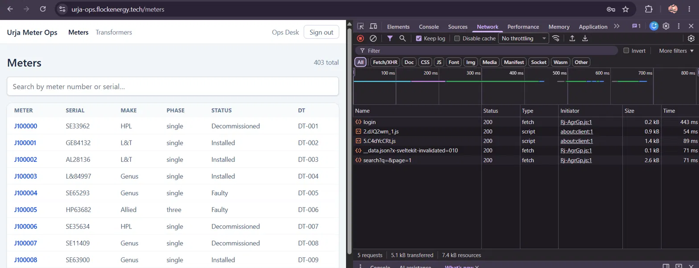 | Meters page with the `login` in the Network tab |
| 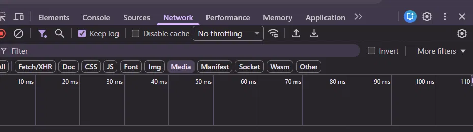 | Meters page's Response tab |
| 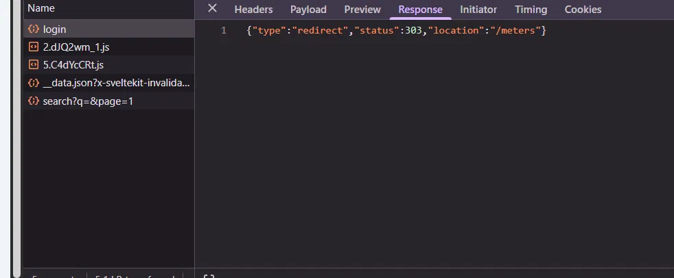 | Login Response tab |
| 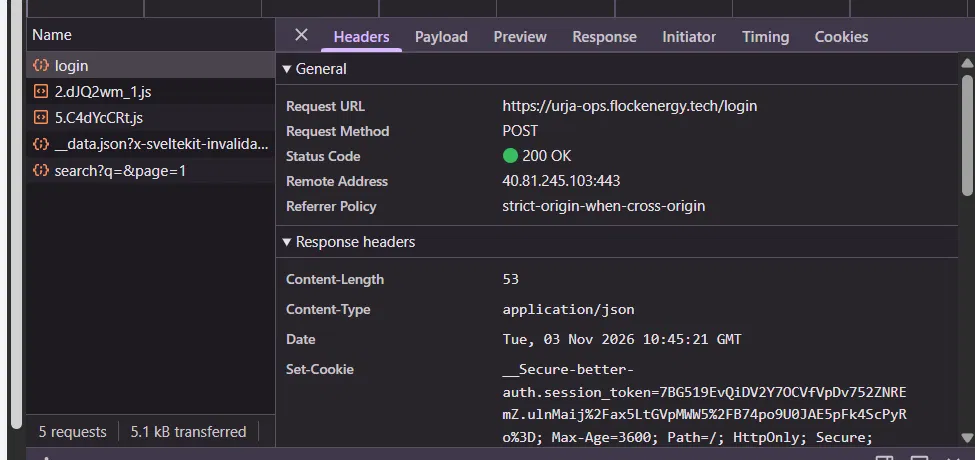 | Login Headers tab |
| 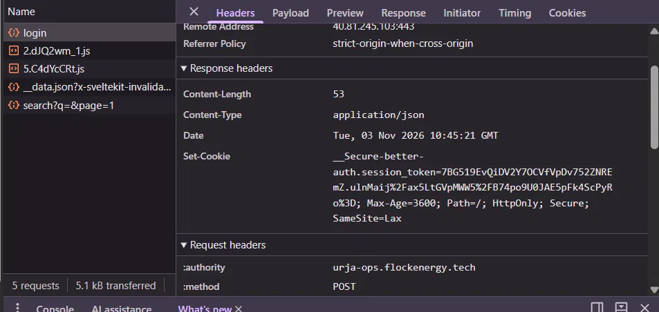 | Login Headers tab (including Cookies) |
| 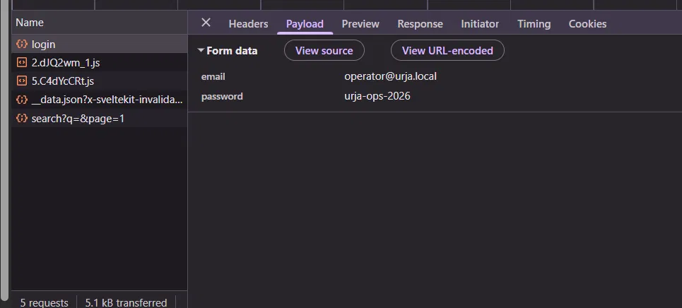 | Login Payload tab |
| 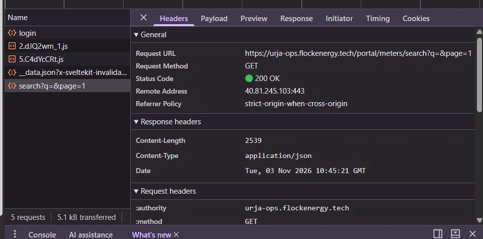 | Search query headers |
| 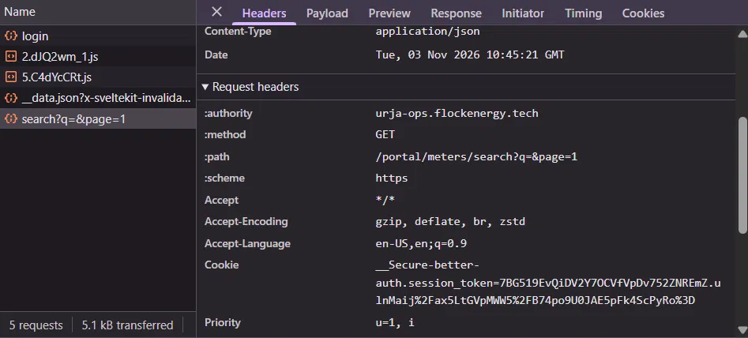 | Search query request headers |
| 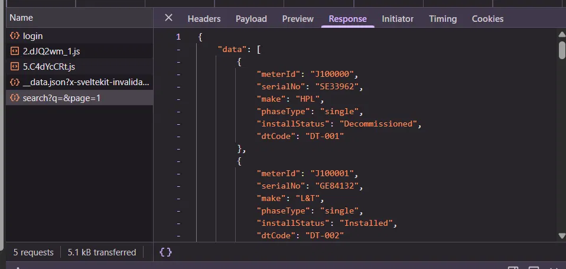 | Search query response |
| 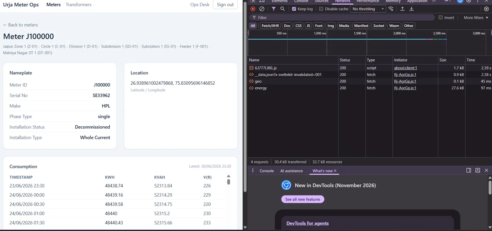 | Meters J100000 requests |
| 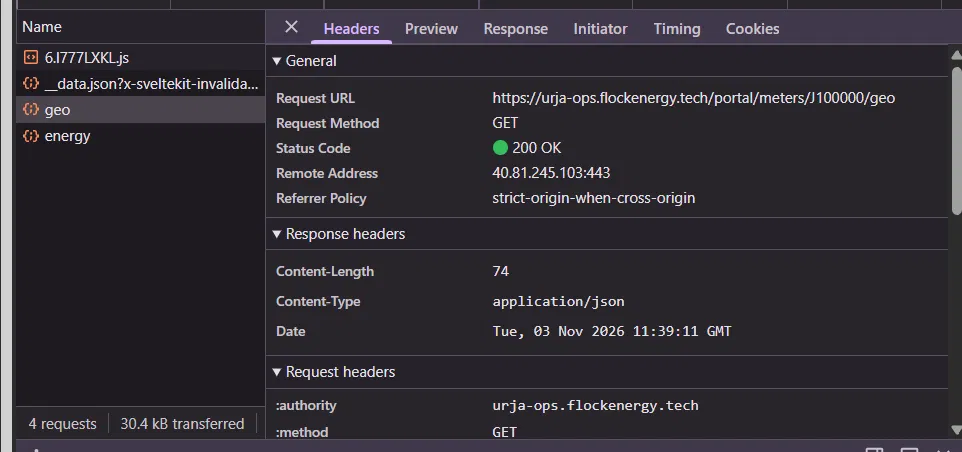 | Meters J100000 geo headers |
| 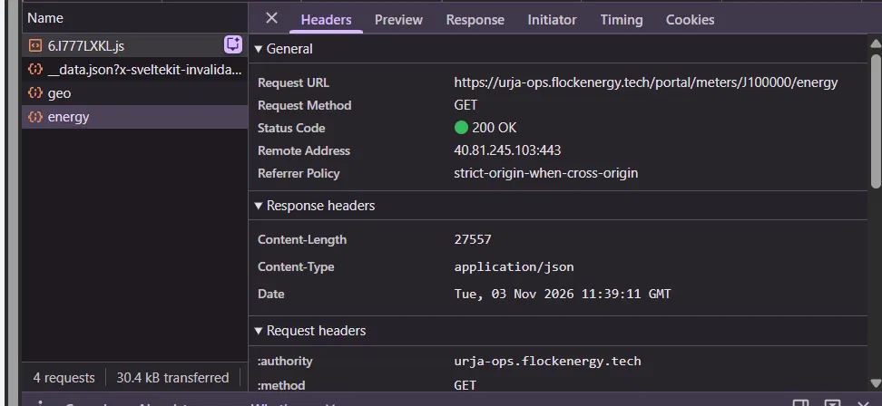 | Meters J100000 energy headers |
| 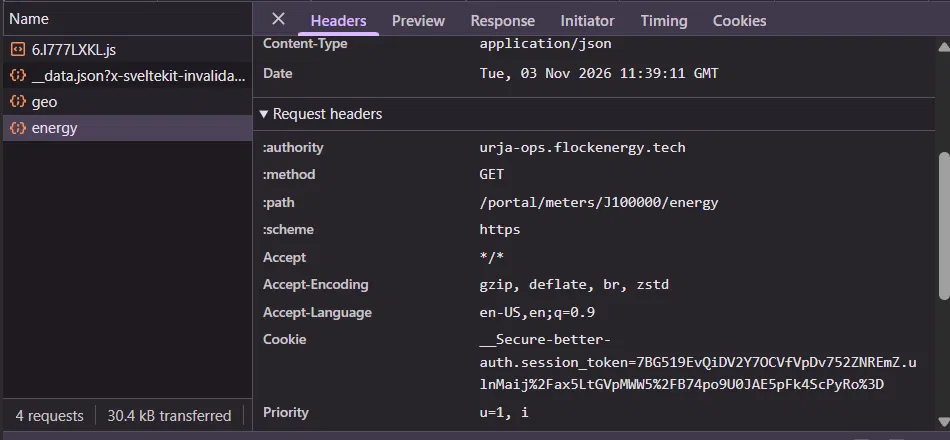 | Meters J100000 energy request headers |
| 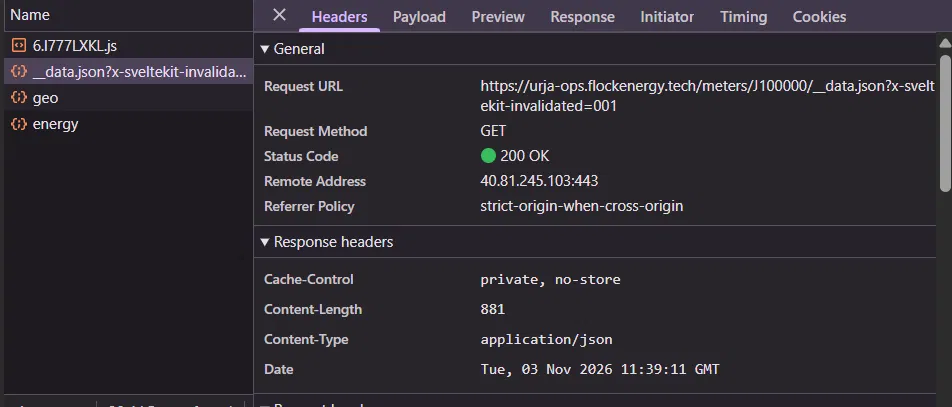 | JSON Data `__data.json` |
| 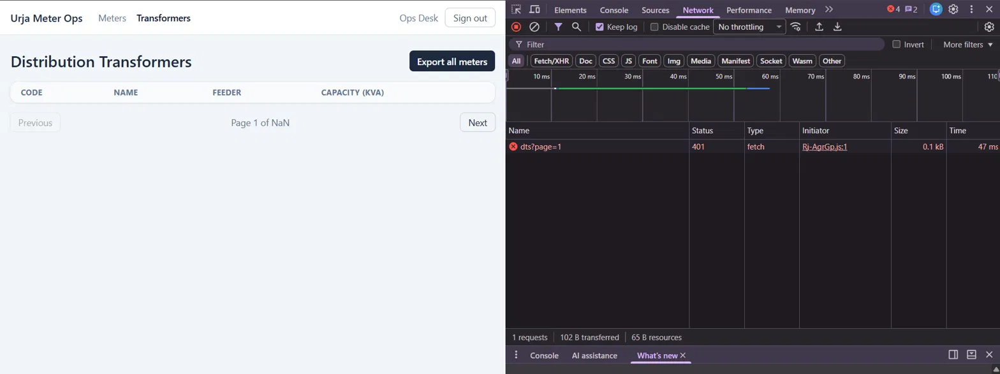 | Transformers page Network tab |
| 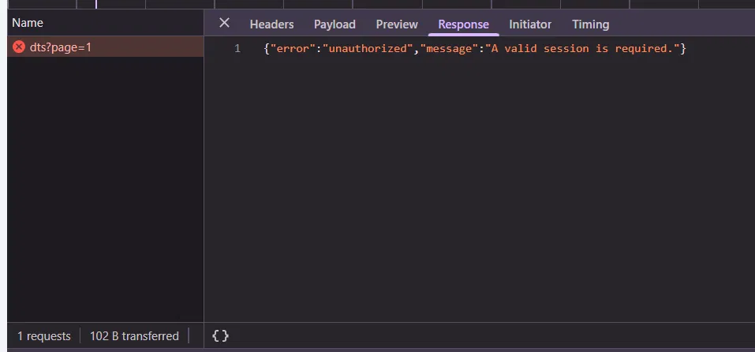 | Transformers session expired |
| 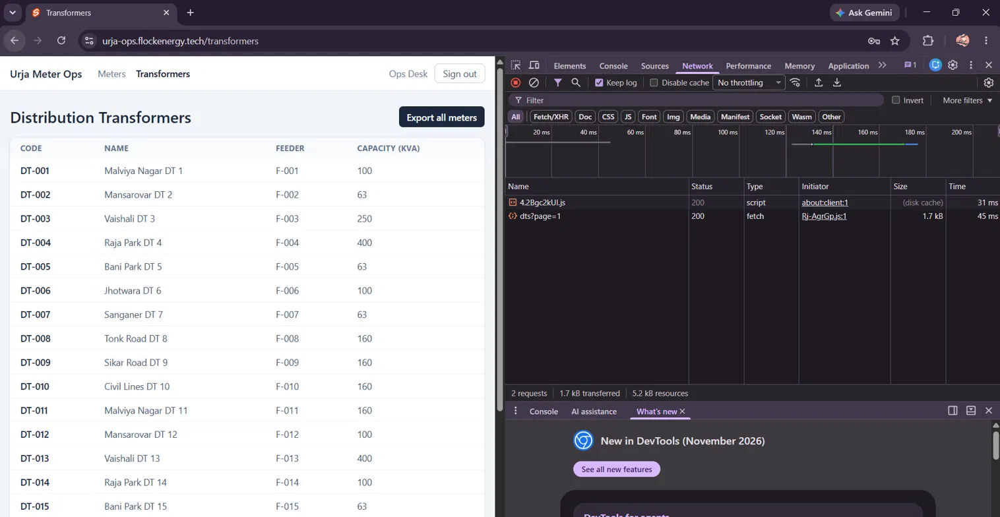 | Transformers network tab |
| 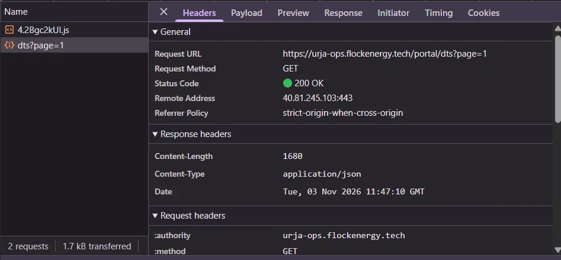 | Bulk Path headers |
| 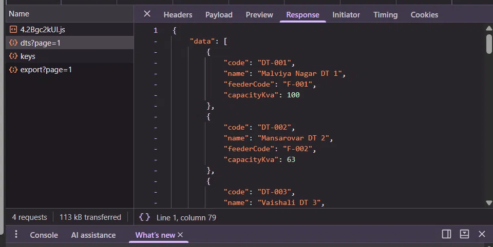 | Bulk Path response |
| 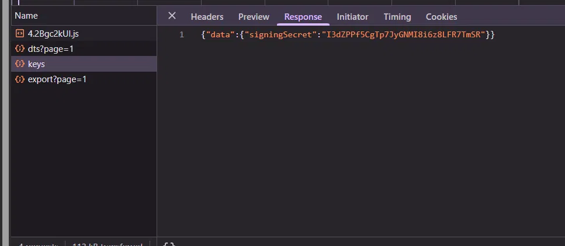 | Sign In secret key |
| 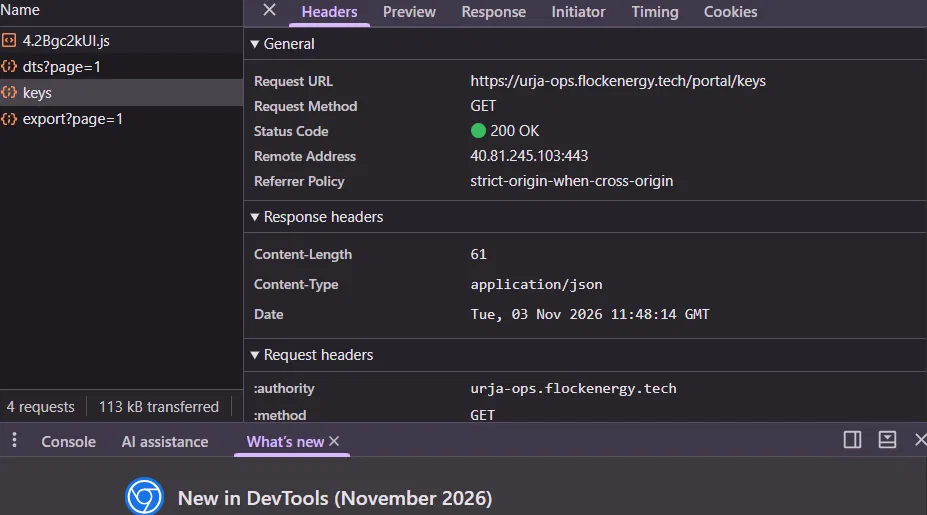 | Sign In secret key headers |
| 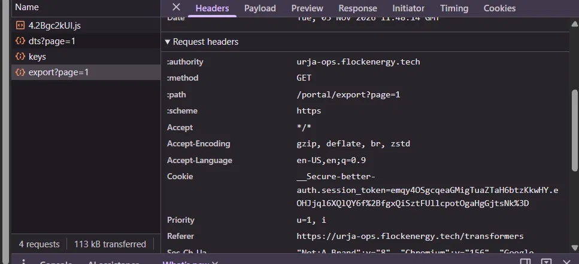 | Export page headers |
| 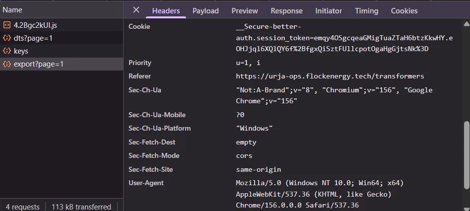 | Export page cookies |
| 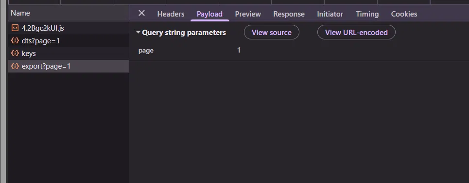 | Export page payload |
|  | Script fail for bulky path data fetching |
